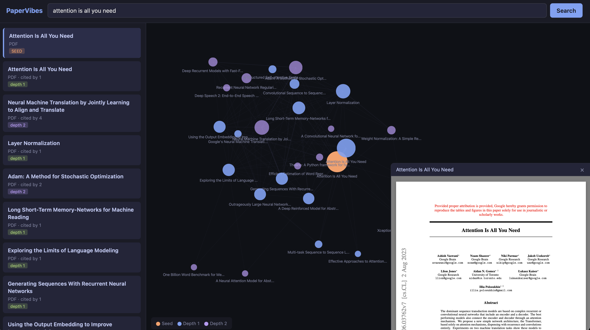

# PaperVibes

An open-source tool for exploring academic paper connections, inspired by [Connected Papers](https://www.connectedpapers.com). Builds citation graphs from real PDFs — no API keys needed.

> *This is an independent project with no affiliation to Connected Papers.*

Search for any academic paper, and PaperVibes will find its PDF, extract all referenced papers via hyperlinks and DOIs, fetch *their* PDFs too, then compute similarity edges based on shared references. The result is an interactive force-directed graph where you can explore how papers relate to each other.



## How it works

1. **Search** — queries DuckDuckGo, returns only results with available PDFs
2. **Depth 1** — downloads the seed paper's PDF, extracts all outgoing paper links (arxiv, DOI, conference URLs)
3. **Depth 2** — fetches PDFs for each depth-1 reference, extracts *their* links, and surfaces new papers cited by 2+ references
4. **Graph** — edges are Jaccard similarity on shared outgoing links; node size is PageRank over the similarity graph
5. **PDF viewer** — click any node to read the paper inline (proxied through the backend)

## Quick start

```bash
pip install -r requirements.txt
python -m uvicorn app:app --port 8000
```

Then open [http://localhost:8000](http://localhost:8000).

## Usage

- **Search** for a paper by title or keywords
- **Click** a search result to build its citation graph (takes 30–90s)
- **Click** a graph node or sidebar entry to open its PDF
- **Double-click** a node to re-center the graph on that paper
- **Drag** nodes to rearrange, scroll to zoom

### Node colors

| Color | Meaning |
|-------|---------|
| Orange | Seed paper |
| Blue | Depth 1 — direct reference from the seed |
| Purple | Depth 2 — discovered from references' references |

Node size reflects PageRank — well-connected hub papers appear larger.

## Stack

- **Backend**: FastAPI + httpx + PyMuPDF
- **Search**: DuckDuckGo HTML scraping (no API key)
- **PDF parsing**: PyMuPDF (hyperlink + text extraction)
- **Frontend**: Single HTML page with D3.js force-directed graph
- **Similarity**: Jaccard index on shared outgoing paper links
- **Ranking**: Weighted PageRank over the similarity graph

## Project structure

```
app.py          — FastAPI routes (search, graph, PDF proxy)
graph.py        — graph building, title resolution, PageRank
papers.py       — PDF link extraction and normalization
search.py       — DuckDuckGo search, PDF download
templates/
  index.html    — single-page frontend (D3.js)
```

## Limitations

- Only finds papers available as PDFs online (mostly arxiv, conference proceedings)
- Reference extraction relies on hyperlinks/DOIs embedded in the PDF — papers without clickable references yield fewer nodes
- Graph building is slow (~60s) since it downloads and parses multiple PDFs sequentially
- DuckDuckGo may rate-limit after many rapid searches

## License

MIT — see [LICENSE](LICENSE).
